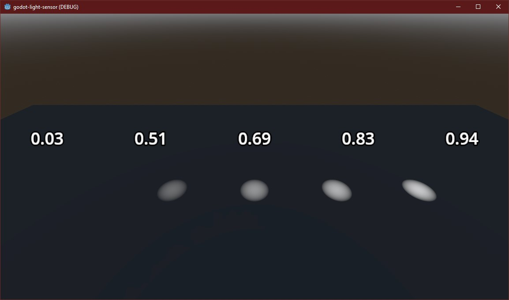

# Godot Light Sensor 3D

Do you need to find the total amount of light reaching a point in your Godot 4 3D project? Then you've come to the right place.

Requires Godot 4.4 or later.

This asset contains a "light sensor" -- a tiny camera pointing at a tiny white plane that can be queried to determine how much light is reaching that plane. You can check the color, too, if you care about that.

## How to Use

1. Create a new node of type LightSensor3D.
2. Move it to the point you want to measure light.
3. Configure the layer.
4. Call the `refresh_async()` method on it periodically, e.g. every second.
5. Query it using the available properties, functions, and signals.

### Positioning and Orientation

The sensor is not a single point in space, capable of reading detecting light in a sphere. It's a plane, which means a couple things:
1. It's recommended to place the sensor low to the ground of your game.
2. It's recommended to orient the sensor so the sensor is pointing "downwards" (this is the default).

These suggestions are assuming you're measuring the amount of light some point on the ground is receiving.

### Configuring the Layer

The internal sensor mesh uses the layer you configure on the light sensor itself. You'll want to choose layer(s) based on the following principles:
1. The layer shouldn't be visible to your main camera, otherwise you'll see a small white plane near the center of the sensor.
2. The layer _should_ be visible to the lights you want to register on the light sensor, otherwise you won't get the desired readings.

### Refreshing the Sensor

Reading the sensor means copying a small texture from the GPU back to the CPU. There are two ways to do it.

`refresh_async()` is the recommended way. It asks the GPU for the texture and returns right away; the reading lands two frames later (about 33ms at 60 FPS) and emits the usual signals. Use `await sensor.refresh_async()` if you need the new values before continuing, or just call it and listen for the signals. Calling it again while a reading is still in flight waits for that reading rather than starting a second one.

`refresh()` does the same work synchronously. It stalls the main thread until the GPU hands the texture back, which costs about 0.1ms per sensor.

Frame time added per reading, measured with 32 sensors on Godot 4.6.1:

| Renderer | `refresh()` | `refresh_async()` |
|----------|-------------|-------------------|
| Forward+ | 0.12ms      | under 0.02ms      |
| Mobile   | 0.08ms      | under 0.02ms      |

You can reproduce these with `tests/benchmarks/benchmark_refresh.gd`; keep its window visible while it runs. Most games don't need to refresh often -- every 250ms is plenty for "is the player standing in shadow?" logic.

`refresh_async()` falls back to `refresh()` in two cases:
* on the Compatibility renderer, which has no RenderingDevice to read from asynchronously
* in low-processor mode, which only draws frames when something changes, so an async reading could wait indefinitely. It logs a warning the first time.

If you call `refresh()` while an async reading is in flight, the async reading is dropped when it lands, since it's older. Callers awaiting it still resume.

While rendering is paused, for example by a minimized window, a pending async reading waits until rendering resumes.

If you free the sensor right after `await sensor.refresh_async()` returns, use `queue_free()` rather than `free()`. The sensor is still emitting the signal that resumed your code, and Godot reports an error if it's freed mid-emission.

Calling refresh is left up to you. The easiest way is to add a child node of the LightSensor3D of type [Timer](https://docs.godotengine.org/en/stable/classes/class_timer.html) that:
* has a wait time of 1 second, or whatever your update frequency need is.
* does **not** have one-shot enabled.
* does have autostart enabled.
* and lastly and most importantly, triggers the parent node's `refresh_async()` method in the `timeout` signal.

There's an included example scene that does this that you can also check out.

### Sanity Check

Things not quite working?

Check:
1. that your light source is on the correct layer(s) and shadows are enabled. Layers are in the VisualInstance3D subsection, and shadows under Light3D > Shadow.
2. that your shadow-casting meshes (e.g. MeshInstance3D) are on the expected layer, configured under VisualInstance3D again.
3. that your LightSensor3D is targeting the layer that's casting light/receiving shadows configured above.

### Outputs

|          | name                | type                                                                     | description                                                                                            |   |   |
|----------|---------------------|--------------------------------------------------------------------------|--------------------------------------------------------------------------------------------------------|---|---|
| property | `color`             | [Color](https://docs.godotengine.org/en/stable/classes/class_color.html) | This is the current color the sensor is seeing.                                                        |   |   |
| property | `light_level`       | float                                                                    | This is the [luminance](https://en.wikipedia.org/wiki/Luminance) seen by the sensor. 0=dark, 1=bright. |   |   |
| signal   | color_updated       | (color: Color)                                                           | Emitted when the current color changes.                                                                |   |   |
| signal   | light_level_updated | (luminance: float)                                                       | Emitted when the light level changes.                                                                  |
Note that all of these require you to call `refresh_async()` or `refresh()` before they'll be updated and triggered.
